<picture>
  <source media="(prefers-color-scheme: dark)" srcset="assets/header-dark.svg">
  
</picture>

 

<picture>
  <source media="(prefers-color-scheme: dark)" srcset="assets/section-about-dark.svg">
  
</picture>

<picture>
  <source media="(prefers-color-scheme: dark)" srcset="assets/about-dark.svg">
  
</picture>

<a href="https://www.youtube.com/watch?v=MSmfAa_oSqE">
<picture>
  <source media="(prefers-color-scheme: dark)" srcset="assets/song-dark.svg">
  
</picture>
</a>

<picture>
  <source media="(prefers-color-scheme: dark)" srcset="https://raw.githubusercontent.com/beedywool/beedywool/cards/home-dark.svg">
  
</picture>
<picture>
  <source media="(prefers-color-scheme: dark)" srcset="https://raw.githubusercontent.com/beedywool/beedywool/cards/dream-dark.svg">
  
</picture>

  

<picture>
  <source media="(prefers-color-scheme: dark)" srcset="assets/section-stats-dark.svg">
  
</picture>

<picture>
  <source media="(prefers-color-scheme: dark)" srcset="https://github-readme-stats.shion.dev/api?username=beedywool&include_all_commits=true&count_private=true&show_icons=true&hide_border=true&border_radius=24&card_width=446&bg_color=211F26&title_color=D0BCFF&text_color=E6E0E9&icon_color=EFB8C8&ring_color=D0BCFF">
  
</picture>
<picture>
  <source media="(prefers-color-scheme: dark)" srcset="https://streak-stats.demolab.com/?user=beedywool&hide_border=true&border_radius=24&card_width=446&card_height=195&background=211F26&ring=D0BCFF&fire=EFB8C8&currStreakNum=E6E0E9&sideNums=E6E0E9&currStreakLabel=D0BCFF&sideLabels=CAC4D0&dates=CAC4D0&stroke=49454F">
  
</picture>

<picture>
  <source media="(prefers-color-scheme: dark)" srcset="https://github-readme-stats.shion.dev/api/top-langs/?username=beedywool&layout=compact&langs_count=10&include_all_commits=true&count_private=true&hide_border=true&border_radius=24&card_width=600&bg_color=211F26&title_color=D0BCFF&text_color=E6E0E9&icon_color=EFB8C8&ring_color=D0BCFF">
  
</picture>

 

<picture>
  <source media="(prefers-color-scheme: dark)" srcset="assets/section-stack-dark.svg">
  
</picture>

<picture>
  <source media="(prefers-color-scheme: dark)" srcset="assets/stack-dark.svg">
  
</picture>
