<a href="https://beedywool.com"><picture><source media="(prefers-color-scheme: dark)" srcset="assets/header-dark.svg"></picture></a>
<a href="https://beedywool.com"><picture><source media="(prefers-color-scheme: dark)" srcset="assets/portfolio-dark.svg"></picture></a>
<picture><source media="(prefers-color-scheme: dark)" srcset="assets/section-about-dark.svg"></picture>
<picture><source media="(prefers-color-scheme: dark)" srcset="assets/sub-intro-dark.svg"></picture>
<picture><source media="(prefers-color-scheme: dark)" srcset="assets/bio-dark.svg"></picture>
<picture><source media="(prefers-color-scheme: dark)" srcset="https://raw.githubusercontent.com/beedywool/beedywool/refs/heads/cards/places-dark.svg"></picture>
<picture><source media="(prefers-color-scheme: dark)" srcset="assets/sub-now-dark.svg"></picture>
<picture><source media="(prefers-color-scheme: dark)" srcset="assets/facts-dark.svg"></picture>
<picture><source media="(prefers-color-scheme: dark)" srcset="assets/sub-favorites-dark.svg"></picture>
<a href="https://www.youtube.com/watch?v=u-vMM6YblOI"><picture><source media="(prefers-color-scheme: dark)" srcset="assets/song-dark.svg"></picture></a>
<a href="https://beedywool.com/#h-favorites"><picture><source media="(prefers-color-scheme: dark)" srcset="assets/favorites-dark.svg"></picture></a>
<picture><source media="(prefers-color-scheme: dark)" srcset="assets/sub-hobby-dark.svg"></picture>
<picture><source media="(prefers-color-scheme: dark)" srcset="assets/hobby-dark.svg"></picture>
<picture><source media="(prefers-color-scheme: dark)" srcset="assets/section-stats-dark.svg"></picture>
<picture><source media="(prefers-color-scheme: dark)" srcset="https://raw.githubusercontent.com/beedywool/beedywool/refs/heads/cards/stats-dark.svg"></picture>
<picture><source media="(prefers-color-scheme: dark)" srcset="assets/section-stack-dark.svg"></picture>
<picture><source media="(prefers-color-scheme: dark)" srcset="assets/stack-dark.svg"></picture>

